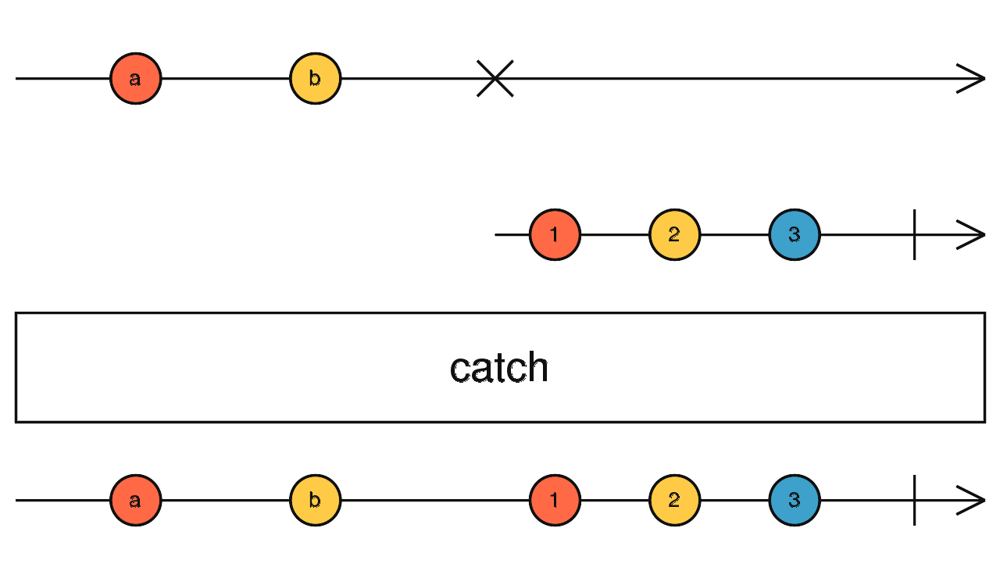

# catchError

Intercepte les erreurs d'un observable et les redirige vers un nouvel observable (ou relance une erreur). N'agit que sur le canal d'erreur ; toutes les valeurs normales sont transmises sans modification.



```ts
import { of, map, catchError } from 'rxjs';

of(1, 2, 3, 4, 5).pipe(
  map(n => {
    if (n === 4) throw 'four!';
    return n;
  }),
  catchError(err => of('I', 'II', 'III', 'IV', 'V'))
).subscribe(console.log);
// 1, 2, 3, I, II, III, IV, V
```

Utilisation typique avec `EMPTY` pour ignorer l'erreur et terminer proprement l'observable :

```ts
import { EMPTY, catchError } from 'rxjs';

source$.pipe(
  catchError(err => {
    console.error(err);
    return EMPTY; // complète sans émettre de valeur
  })
)
```
