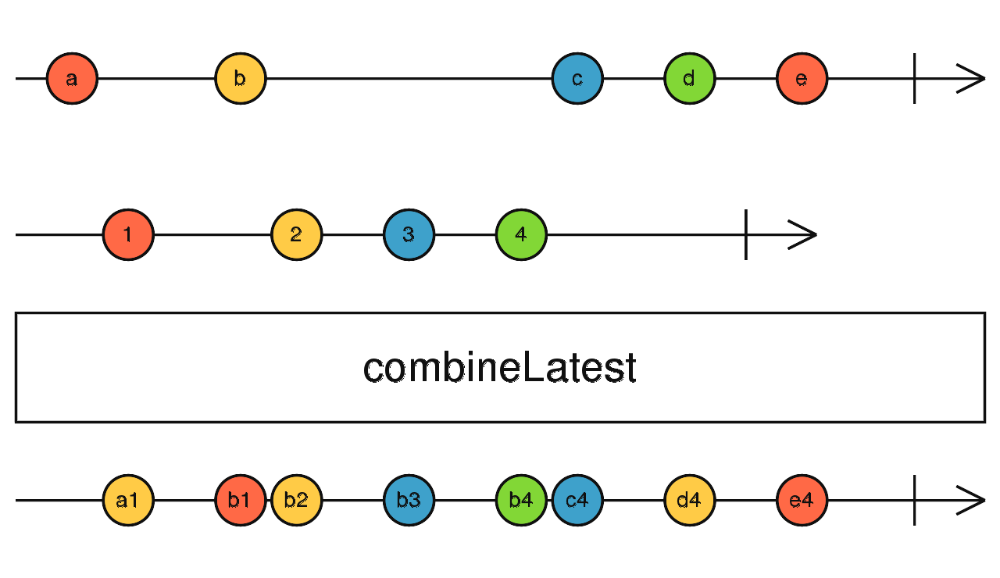

# combineLatest

Émet un tableau des dernières valeurs de chaque observable source dès que l'un d'eux émet (après que tous aient émis au moins une fois).



```ts
import { combineLatest, of } from 'rxjs';

combineLatest([
    of(1, 2),
    of('a', 'b')
]).subscribe(console.log);
// [2, 'a'], [2, 'b']
```
