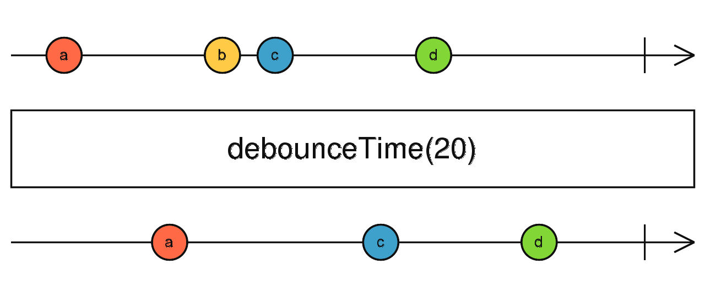

# debounceTime

N'émet une valeur qu'après un silence de `n` ms ; réinitialise le délai à chaque nouvelle émission.



```ts
import { fromEvent } from 'rxjs';
import { debounceTime } from 'rxjs/operators';

// En supposant que source$ émet des événements
source$.pipe(
  debounceTime(300)
).subscribe(console.log);
```
