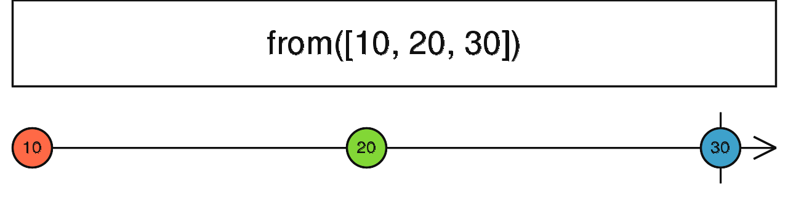

# from

Fonction qui crée un Observable à partir d'une Promise, d'un tableau, d'un itérable ou d'un objet similaire à un Observable. La valeur émise est la valeur résolue de la source, puis l'Observable se complète.



```ts
import { from } from 'rxjs';

// À partir d'une Promise
const promise = Promise.resolve(42);
from(promise).subscribe(console.log);
// 42

// À partir d'un tableau
from([1, 2, 3]).subscribe(console.log);
// 1
// 2
// 3
```
