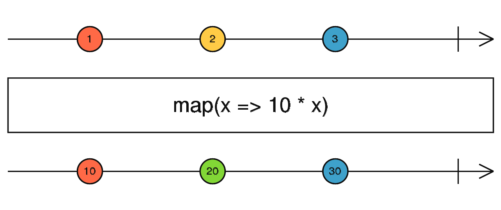

# map

Transforme chaque valeur émise en appliquant une fonction.



```ts
import { of } from 'rxjs';
import { map } from 'rxjs/operators';

of(1, 2, 3).pipe(
  map(x => x * 10)
).subscribe(console.log);
// 10, 20, 30
```
