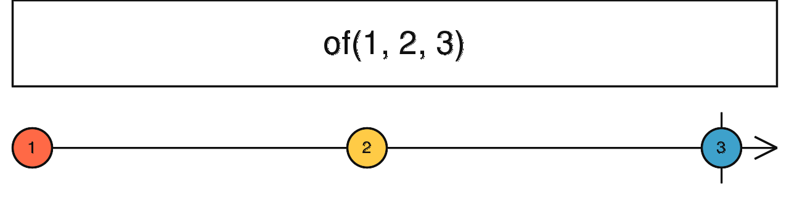

# of

Fonction N-aire qui crée un Observable qui émet les valeurs passées en arguments puis complète.



```ts
import { of } from 'rxjs';

of(1, 2, 3).subscribe(console.log);
// 1
// 2
// 3

of( [1, 2, 3] ).subscribe(console.log);
// [1, 2, 3]
```
