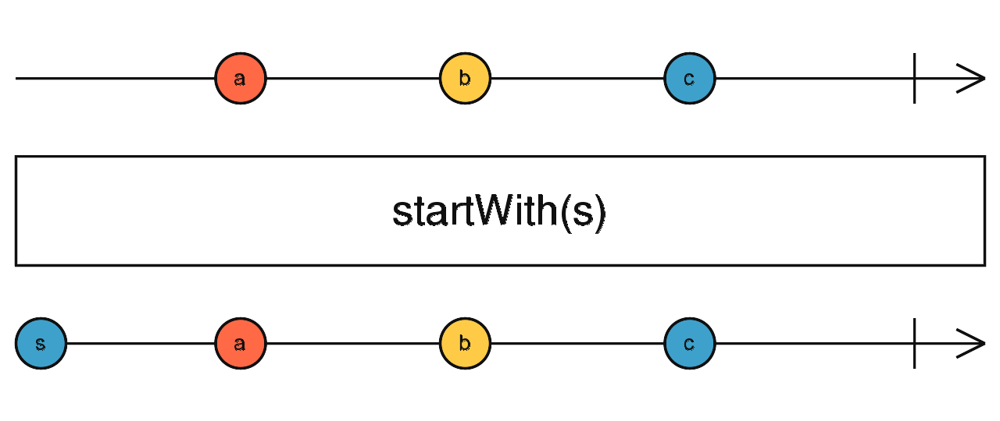

# startWith

Opérateur qui émet de façon synchrone les valeurs fournies en argument **avant** de s'abonner à la source et d'en relayer les émissions.



```ts
import { timer, map, startWith } from 'rxjs';

timer(1000)
  .pipe(
    map(() => 'timer emit'),
    startWith('timer start')
  )
  .subscribe(x => console.log(x));

// 'timer start'   ← émis immédiatement à la souscription
// 'timer emit'    ← émis après 1 seconde
```
