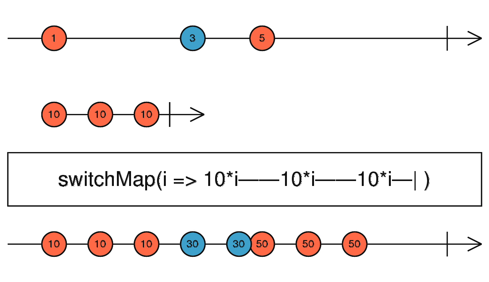

# switchMap

Projette chaque valeur vers un Observable interne ; annule l'abonnement précédent à chaque nouvelle valeur.



Exemple :
```ts
import { of } from 'rxjs';
import { switchMap } from 'rxjs/operators';

// Observable qui émet "Ping 0", "Ping 1", "Ping 2" à un intervalle de 1s
const inter1s3fois$ = interval(1000).pipe(
  map(i => `Ping ${i}`),
  take(3)
);

// Fonction qui prend en paramètre une string
// et renvoie un observable qui émet "${str} : Tick 0", "${str} : Tick 1", "${str} : Tick 2", "${str} : Tick 3", "${str} : Tick 4" à un intervalle de 400ms
const fctInter400ms5Fois$ = (str: string) => interval(400).pipe(
  map(i => `${str} : Tick ${i}`),
  take(5)
);

// À chaque émission de inter1s3fois$, switchMap s'abonne à inter400ms5Fois$ et émet ses valeurs
// Cependant, à chaque nouvelle émission de inter1s3fois$, le précédent abonnement à inter400ms5Fois$ est annulé
const inter400ms5Fois$ = interval(400).pipe(
  switchMap( fctInter400ms5Fois$ )
).subscribe( console.log );
// Ping 0 : Tick 0
// Ping 0 : Tick 1
// Ping 1 : Tick 0
// Ping 1 : Tick 1
// Ping 2 : Tick 0
// Ping 2 : Tick 1
// Ping 2 : Tick 2
// Ping 2 : Tick 3
// Ping 2 : Tick 4

```
