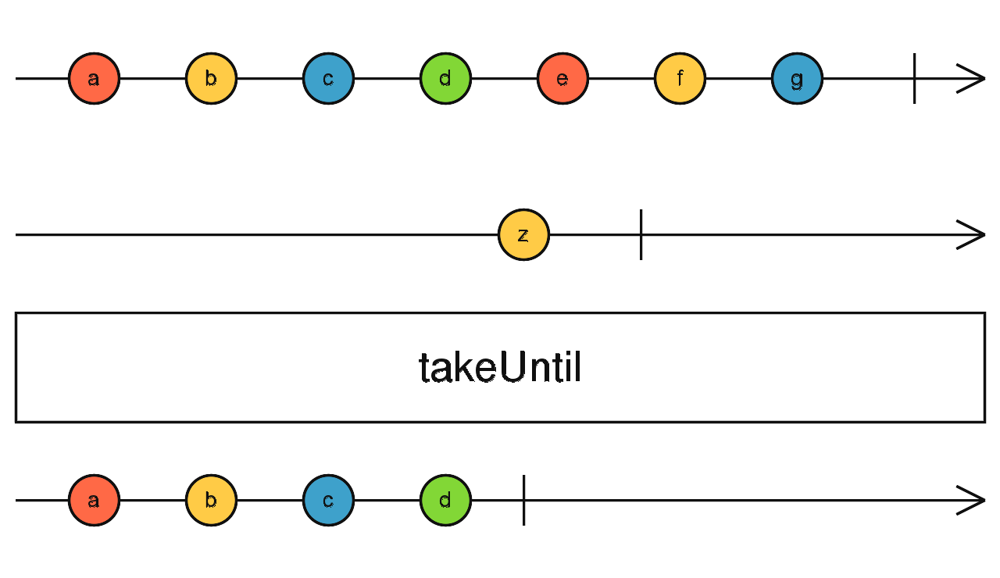

# takeUntil

Laisse passer les valeurs de l'observable source jusqu'à ce qu'un second observable (`notifier`) émette une valeur. À ce moment, l'observable résultant complète.



```ts
import { interval, fromEvent, takeUntil } from 'rxjs';

const source = interval(1000);
const clicks$ = fromEvent(document, 'click');

source.pipe(
  takeUntil(clicks$)
).subscribe(x => console.log(x));

// émet 0, 1, 2, ... jusqu'au premier clic, puis s'arrête
```
