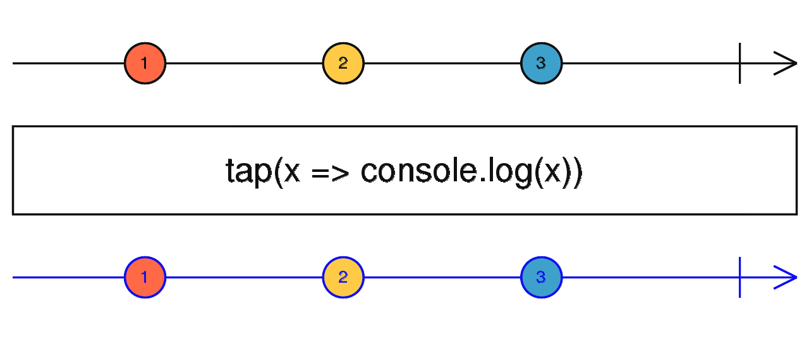

# tap

Opérateur utilisé pour effectuer des effets de bord sur les notifications d'un observable source, sans modifier les valeurs émises.



Cas d'usage typique : déboguer un pipeline en loggant les valeurs.

```ts
import { of, tap, map } from 'rxjs';

of(Math.random()).pipe(
  tap(console.log),         // affiche la valeur brute avant transformation
  map(n => n > 0.5 ? 'big' : 'small')
).subscribe(console.log);
```

`tap` peut aussi réagir à la complétion ou à une erreur :

```ts
source$.pipe(
  tap({
    next:     value    => console.log('valeur :', value),
    error:    err      => console.error('erreur :', err),
    complete: ()       => console.log('terminé')
  })
)
```
